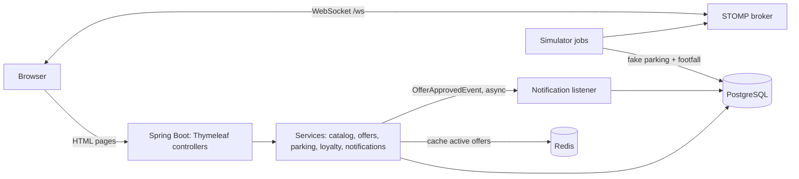

# MallHub - all Bengaluru malls on one website

Live demo: https://mall-1-rttl.onrender.com

A multi-mall platform: one website where visitors can browse every mall in Bengaluru, search stores across malls,
see offers, check live parking, book a slot, and earn loyalty points. Mall admins manage stores and offers.

**Stack:** Java 21, Spring Boot 3.3, Thymeleaf + Bootstrap, PostgreSQL (Flyway), Redis, WebSocket (STOMP),
Spring Security, Docker Compose, JUnit + Testcontainers.

## Run it

Requirements: Java 21, Maven 3.9+, Docker.

```bash
docker compose up -d          # PostgreSQL + Redis
mvn spring-boot:run           # start the website
```
Open http://localhost:8080

Or run everything in containers: `docker compose --profile full up --build`

## Demo accounts (created on first start, CHANGE before any public deploy)

| Role | Email | Password |
|---|---|---|
| Super admin | admin@mallhub.com | admin123 |
| Mall admin (first mall only) | mall.admin@mallhub.com | admin123 |
| User | user@mallhub.com | user123 |

Anyone can also register at `/register` (always a plain USER).

## Features

| Area | What it does |
|---|---|
| Catalog | 6 Bengaluru malls, floors, categories, stores. Cross-mall store search, "malls near me" (Haversine) |
| Bulk import | Admin uploads a CSV of stores (`sample-data/stores-sample.csv`) |
| Offers | Mall admins submit offers, a super admin approves them. Active offers cached in Redis |
| Parking | Live availability pushed over WebSocket, booking with row locking, cancel, "find my car", auto-expiry |
| Rewards | Submit a bill (optional photo), admin verifies, points ledger, redeem with idempotency |
| Notifications | Approving an offer notifies all users in-app (async) and calls an email stub |
| Admin dashboard | Totals, per-mall stats, footfall chart, parking occupancy |
| Security | Session login, BCrypt, roles, CSRF on forms, bill photos visible to admins only |

## Architecture



It is a modular monolith: one deployable, with a package per module (`catalog`, `offer`, `parking`, `loyalty`,
`notification`, `admin`, `user`, `security`). Each could become its own service later.

## Design decisions worth explaining in an interview

- **No double booking.** `book()` locks the zone's `parking_status` row with `SELECT ... FOR UPDATE`, so concurrent
  requests queue up. A partial unique index (`uq_active_slot`) is a second safety net in the database.
- **Points can never double-credit.** `UNIQUE (store_id, bill_no)` stops the same bill being claimed twice. The
  ledger is append-only, and each credit carries a unique `idempotency_key`, so verifying twice adds points once.
- **Redeem is safe to double-click.** The form sends a one-time key. The user row is locked while the balance is
  checked, so concurrent redemptions cannot overspend.
- **Flyway owns the schema**, Hibernate only validates it. SQL-heavy modules use `JdbcClient` with records.
- **Cache failure is not site failure.** If Redis is down, a cache error handler logs and falls back to the database.
- **Session login, not JWT.** This is a server-rendered website, so the session cookie is the simpler, safer fit.
- **Async notifications.** Spring events plus `@Async`. The same event could be published to RabbitMQ or Kafka later.

## Data honesty

- Mall names are real, but **coordinates are approximate** and the **stores, offers, parking and footfall numbers
  are demo/simulated**. There is no public dataset of mall stores; real data comes from the admin CSV import or from
  mall partners. Verify coordinates before relying on "near me".
- Turn the simulator off with `mallhub.simulator.enabled=false`, and demo seeding with `mallhub.demo-data.enabled=false`.

## Tests

```bash
mvn test       # Testcontainers tests need Docker running
```
- `ConcurrencyTest`: 50 people race for 10 parking slots (exactly 10 win); a bill verified 10 times credits once;
  duplicate bills rejected; redeem is idempotent and cannot overspend.
- `GeoUtilTest`, `CsvParsingTest`: fast unit tests.

CI runs `mvn verify` on every push (`.github/workflows/ci.yml`).

## Project layout

```
src/main/java/com/mallhub/
  catalog/  mall/  offer/  parking/  loyalty/  notification/  admin/  user/  security/  common/
src/main/resources/
  db/migration/   V1 schema, V2 notification read flag
  templates/      Thymeleaf pages
sample-data/      stores-sample.csv
```

## Ideas for next steps

Indoor navigation (graph + Dijkstra on a floor map), real push notifications, geo-fenced alerts,
Elasticsearch for search, JWT for the JSON API, a load test with k6 for the booking endpoint.

## Deploying publicly (free tier, e.g. Render)

1. Push this project to a GitHub repository.
2. Create a free PostgreSQL database on the host, then a Web Service from the repo using the **Dockerfile**.
3. Set these environment variables on the web service:

| Variable | Value |
|---|---|
| `SPRING_DATASOURCE_URL` | `jdbc:postgresql://<db-host>:5432/<db-name>` (use the database's internal host) |
| `SPRING_DATASOURCE_USERNAME` | database user |
| `SPRING_DATASOURCE_PASSWORD` | database password |
| `MALLHUB_ADMIN_PASSWORD` | a strong password for admin@mallhub.com |
| `MALLHUB_DEMO_ACCOUNTS` | `false` (removes the public demo logins) |
| `SPRING_CACHE_TYPE` | `none` (unless you also add a Redis instance) |

4. Set the health check path to `/actuator/health`.

Free tiers sleep when idle (first visit is slow), free databases may expire, and uploaded bill images are lost on
redeploy (the database rows stay). Check the host's current free-tier terms.
